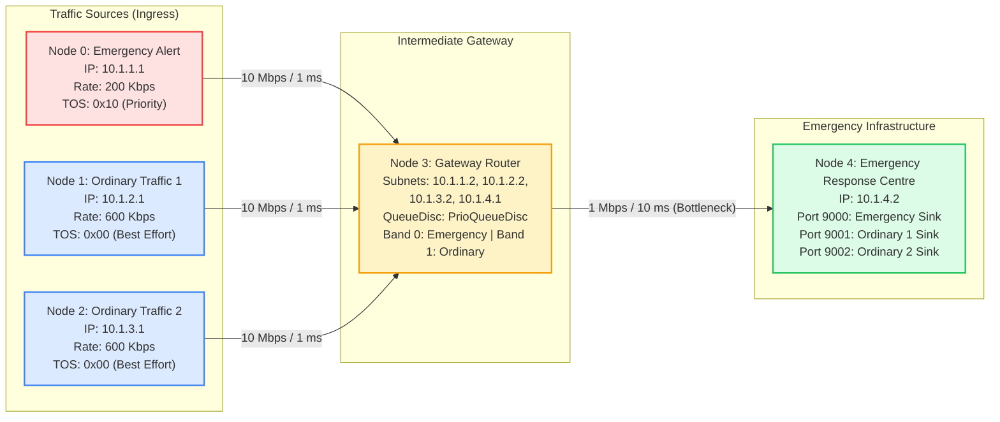
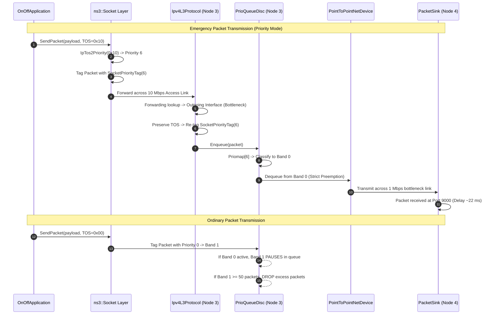

# Smart Emergency Alert and Priority Messaging Network
## Comprehensive Academic Project Report

**Course:** B.Tech Network Programming (NWP) Laboratory / Mini-Project  
**Simulator Platform:** Network Simulator 3 (ns-3.49)  
**Host Environment:** macOS Apple Silicon (ARM64)  
**Implementation Source:** [`scratch/smart-emergency-priority.cc`](file:///Users/ravo/Downloads/ns-3.49/scratch/smart-emergency-priority.cc)  
**Repository Location:** `/Users/ravo/Downloads/ns-3.49`

---

## Abstract

During natural disasters, humanitarian crises, and public safety emergencies, communication networks experience catastrophic traffic overload. Telecommunication towers, regional aggregation routers, and edge gateways become choked with civilian best-effort traffic—such as status updates, voice calls, and video streams. In traditional First-In-First-Out (FIFO) queueing architectures, life-critical emergency alerts and disaster coordination telemetry are placed into the same buffer backlog as recreational traffic, resulting in severe end-to-end delays (often hundreds of milliseconds to seconds) or catastrophic packet drops due to buffer overflow.

This project designs, implements, and evaluates the **Smart Emergency Alert and Priority Messaging Network** using **ns-3.49**. We demonstrate how Differentiated Services (DiffServ) and strict priority queueing (`PrioQueueDisc`) at the network Traffic Control layer isolate critical alerts from background congestion. We construct a 5-node topology with dedicated 10 Mbps access links and a shared 1.0 Mbps bottleneck link overloaded by 40% (1.4 Mbps offered load, with ordinary traffic alone accounting for 1.2 Mbps). 

Through empirical evaluation using `FlowMonitor` and gateway `QueueDisc` inspection, we demonstrate that priority scheduling slashes emergency alert mean end-to-end delay from **231.60 ms** in FIFO baseline mode down to **22.26 ms**—a **90.4% latency reduction**—while ensuring **100.0% packet delivery ratio (PDR)** and **zero queue drops** in the priority band (compared to FIFO baseline emergency PDR of **53.4%** with **659.3** lost packets). Non-critical traffic deterministically absorbs the preemption trade-off (+24.4% delay and 3,169.6 packet drops), maintaining total bottleneck utilization at 99.8%.

> **Disclaimer:** This project is a discrete-event network simulation designed for academic research and education. It models network-layer packet scheduling and queue dynamics; it is not a real-world deployed emergency dispatch system. Priority queueing optimizes packet transit through congested queues, but cannot prevent packet loss caused by physical link severance, hardware failure, or total channel collapse.

---

## 1. Title and Abstract
- **Project Title:** Smart Emergency Alert and Priority Messaging Network
- **Academic Domain:** Computer Science & Engineering / Information Technology — Computer Networks & Network Programming
- **Core Technology:** ns-3.49, C++17, Linux-style Traffic Control (`PrioQueueDisc`), IPv4 Type of Service (DiffServ), FlowMonitor, NetAnim.

---

## 2. Introduction and Motivation

In the modern digital era, society relies heavily on IP-based communication for everyday life and critical infrastructure. When an emergency occurs—such as an earthquake, flood, wildfire, or industrial hazard—two contradictory communication dynamics collide:
1. **Civilian Communication Surge:** Thousands of citizens simultaneously access the network to contact loved ones, stream news, or post to social media, causing traffic volume to spike well beyond network capacity.
2. **First-Responder & Alert Dispatches:** Emergency response agencies must broadcast urgent evacuation orders, deploy first-responder teams, and receive sensor telemetry with sub-second guarantees.

When an intermediate router treats all packets equally using default FIFO queueing, emergency packets arrive at the tail of heavily backlogged queues. Every millisecond of latency in an evacuation broadcast directly impairs life safety. Network-layer Quality of Service (QoS) and traffic classification provide the deterministic mechanism required to segregate and prioritize critical packets without needing to over-provision expensive physical bandwidth.

---

## 3. Problem Statement

Given a congested IP network where total offered traffic exceeds available bottleneck bandwidth:
- In default **FIFO Queueing**, packets are serviced strictly in arrival order. Emergency alerts and low-priority messages compete for identical buffer slots.
- Under heavy congestion, queues operate near capacity, imposing maximum queueing latency on all traffic classes and indiscriminately dropping packets when buffers overflow.
- **The Challenge:** To implement an automated network-level classification and scheduling mechanism in ns-3.49 that ensures emergency alert packets experience zero queueing wait and zero drops during sustained 140% link overload, while analyzing the exact performance trade-offs imposed on background civilian traffic.

---

## 4. Project Objectives

1. **Topology Realization:** Construct a deterministic 5-node star network in ns-3.49 with dedicated high-speed access links and a shared low-capacity bottleneck link.
2. **Controlled Congestion Generation:** Design concurrent UDP traffic flows where ordinary background traffic alone (1.2 Mbps) exceeds bottleneck capacity (1.0 Mbps), with total offered load reaching 1.4 Mbps.
3. **DiffServ Priority Architecture:** Utilize IPv4 Type of Service (TOS) tagging (`0x10`) at the application layer, map it across the socket layer to `SocketPriorityTag`, and schedule it at the router egress using `PrioQueueDisc`.
4. **Empirical Performance Comparison:** Quantitatively evaluate Baseline (FIFO) vs. Priority (`PrioQueueDisc`) across:
   - Packet Delivery Ratio (PDR %)
   - Average End-to-End Delay (ms)
   - Delay Variation / Jitter (ms)
   - Effective Throughput (Kbps)
   - Gateway Queue Disc Drop Counts
5. **Reproducible Presentation Pipeline:** Automate simulation execution, FlowMonitor XML parsing, CSV generation, visual chart plotting, and NetAnim animation generation.

---

## 5. Existing Approach vs. Proposed Approach

| Feature | Existing Approach (Best-Effort FIFO) | Proposed Approach (DiffServ + PrioQueueDisc) |
| :--- | :--- | :--- |
| **Queue Discipline** | Single FIFO Queue (`FifoQueueDisc`) | Classful 3-Band Priority Queue (`PrioQueueDisc`) |
| **Packet Classification** | None; all packets treated equally | TOS `0x10` $\rightarrow$ Priority 6 $\rightarrow$ Band 0 (Emergency)<br>TOS `0x00` $\rightarrow$ Priority 0 $\rightarrow$ Band 1 (Ordinary) |
| **De-queue Policy** | Strict First-In First-Out | Strict Priority: Band 0 is drained before Band 1 |
| **Emergency Latency** | High (~231.60 ms due to full queue backlog) | Minimal (~22.26 ms; transmission + propagation only) |
| **Emergency Drop Rate** | Vulnerable to tail-drop during buffer overflow (~53.4% PDR, ~659 packets lost) | Zero drops (100.0% PDR; Band 0 is continuously drained) |
| **Ordinary Traffic Impact**| Shares drops and latency equally | Absorbs preemption delay (+24.4%) and 100% of buffer drops (3,169.6 drops) |
| **Bandwidth Efficiency** | 100% utilized | 100% utilized (work-conserving queueing) |

---

## 6. System Architecture & Network Topology Diagram

```
+---------------------------+       10 Mbps, 1 ms
|  Node 0: Emergency Source |--------------------+
+---------------------------+                     \
                                                   \
+---------------------------+       10 Mbps, 1 ms   v  +---------------------------+   1 Mbps, 10 ms   +------------------------------+
|  Node 1: Ordinary Source 1|------------------------->|  Node 3: Gateway Router   |------------------>| Node 4: Response Centre      |
+---------------------------+                       ^  | (Traffic Control Layer)   |  [Bottleneck]     | (Destination Server)         |
                                                   /   +---------------------------+                   +------------------------------+
+---------------------------+       10 Mbps, 1 ms /          |
|  Node 2: Ordinary Source 2|--------------------+           |-- NetDevice Queue: 1p
+---------------------------+                                |-- QueueDisc:
                                                                 - Baseline: FifoQueueDisc (50p)
                                                                 - Priority: PrioQueueDisc (3 x 50p bands)
```

### Detailed Network Map


---

## 7. Hardware and Software Specifications

### Hardware Platform
- **Processor:** Apple M-Series Silicon (ARM64 architecture)
- **Memory:** Unified Memory Architecture (16 GB+)
- **Storage:** Solid State Storage (APFS)

### Software Environment
- **Operating System:** macOS 15+ (Darwin Kernel)
- **Simulator Version:** ns-3.49 (configured with C++17)
- **Build System:** CMake 3.28+ with Ninja backend
- **Compiler:** Apple Clang version 16.0+ (`clang-1600.x`)
- **Scripting & Data Analysis:** Python 3.12, Pillow 12.3.0, Plotly 6.7.0
- **Visualization:** NetAnim 3.109

---

## 8. Technologies & ns-3 Modules Utilized

1. **`core`:** Simulation clock, event scheduling (`Simulator::Schedule`), random number generation (`RngSeedManager`), and command-line parsing (`CommandLine`).
2. **`network`:** Node representation (`NodeContainer`), packet buffer management (`Packet`), socket abstractions (`Socket`), and priority tags (`SocketPriorityTag`).
3. **`internet`:** IPv4 Layer 3 stack (`Ipv4L3Protocol`), routing engines (`Ipv4GlobalRoutingHelper`), and UDP transport (`UdpSocketFactory`).
4. **`point-to-point`:** Channel modeling (`PointToPointHelper`), net devices (`PointToPointNetDevice`), and propagation delay models.
5. **`traffic-control`:** Queue management framework (`TrafficControlHelper`), FIFO queue discipline (`FifoQueueDisc`), and priority discipline (`PrioQueueDisc`).
6. **`applications`:** Constant traffic generation (`OnOffApplication`) and packet reception sinks (`PacketSink`).
7. **`flow-monitor`:** Probe-based measurement framework (`FlowMonitor`, `FlowMonitorHelper`, `Ipv4FlowClassifier`).
8. **`netanim` & `mobility`:** XML trace generation (`AnimationInterface`) and node coordinates (`ConstantPositionMobilityModel`).

---

## 9. Network Topology, Addressing, and Traffic Parameters

### Subnet Layout
| Subnet CIDR | Node A | IP Address A | Node B | IP Address B | Link Bandwidth | Propagation Delay |
| :--- | :--- | :--- | :--- | :--- | :--- | :--- |
| `10.1.1.0/24` | Node 0 (Emergency) | `10.1.1.1` | Node 3 (Gateway) | `10.1.1.2` | 10 Mbps | 1 ms |
| `10.1.2.0/24` | Node 1 (Ordinary 1) | `10.1.2.1` | Node 3 (Gateway) | `10.1.2.2` | 10 Mbps | 1 ms |
| `10.1.3.0/24` | Node 2 (Ordinary 2) | `10.1.3.1` | Node 3 (Gateway) | `10.1.3.2` | 10 Mbps | 1 ms |
| `10.1.4.0/24` | Node 3 (Gateway) | `10.1.4.1` | Node 4 (Server) | `10.1.4.2` | **1 Mbps** | **10 ms** |

### Traffic Flow Matrix
| Flow Name | Source Node | Destination IP:Port | Data Rate | Packet Size | TOS Byte | Socket Priority | Queue Band |
| :--- | :---: | :---: | :---: | :---: | :---: | :---: | :---: |
| **Emergency Alert** | Node 0 | `10.1.4.2:9000` | 200 Kbps | 512 bytes | `0x10` (Priority) / `0x00` (Base) | 6 / 0 | Band 0 / FIFO |
| **Ordinary Msg 1** | Node 1 | `10.1.4.2:9001` | 600 Kbps | 512 bytes | `0x00` | 0 | Band 1 / FIFO |
| **Ordinary Msg 2** | Node 2 | `10.1.4.2:9002` | 600 Kbps | 512 bytes | `0x00` | 0 | Band 1 / FIFO |

---

### Detailed Theoretical Delay Formulation & Header Breakdown
To evaluate the queueing performance with mathematical rigor, we derive the exact end-to-end transmission delay across the 2-hop topology.

#### 1. On-the-Wire Packet Size
For an application payload of $L_{\text{payload}} = 512\text{ bytes}$:
- **UDP Header (RFC 768):** 8 bytes
- **IPv4 Header (RFC 791):** 20 bytes (standard, no IP options)
- **Point-to-Point Data Link Header (ns-3 PointToPointNetDevice):** 2 bytes protocol framing
- **Total on-wire frame size ($L_{\text{wire}}$):** $512 + 8 + 20 + 2 = 542\text{ bytes} = 4,336\text{ bits}$.

#### 2. Transmission & Propagation Delays
- **Access Link ($R_{\text{access}} = 10\text{ Mbps}$, $D_{\text{prop, access}} = 1.0\text{ ms}$):**
  $$T_{\text{access}} = \frac{4,336\text{ bits}}{10{,}000{,}000\text{ bps}} = 0.4336\text{ ms} = 433.6\text{ }\mu\text{s}$$
- **Bottleneck Link ($R_{\text{bottleneck}} = 1\text{ Mbps}$, $D_{\text{prop, bottle}} = 10.0\text{ ms}$):**
  $$T_{\text{bottleneck}} = \frac{4,336\text{ bits}}{1{,}000{,}000\text{ bps}} = 4.336\text{ ms}$$

#### 3. Theoretical Minimum Delay (Zero Queueing Wait)
Under zero queueing congestion, the absolute theoretical minimum transit delay is:
$$D_{\text{min, zero\_wait}} = D_{\text{prop, access}} + T_{\text{access}} + D_{\text{prop, bottle}} + T_{\text{bottleneck}} = 1.0 + 0.4336 + 10.0 + 4.336 = 15.77\text{ ms}$$

#### 4. Priority Queueing Delay Derivation ($D_{\text{theory, prio}}$)
In physical network transceivers and in ns-3, packet transmission on physical links is **strictly non-preemptive**: once a packet begins serialization onto the 1 Mbps channel, transmission cannot be interrupted even if an emergency packet arrives at Gateway Node 3 a microsecond later.
All packets in the network have 512 bytes application payload ($L_{\text{wire}} = 542\text{ bytes}$ on the wire). Serialization of one packet on the 1 Mbps bottleneck link takes:
$$T_{\text{bottleneck}} = \frac{542 \times 8}{1{,}000{,}000} = 4.336\text{ ms} \approx 4.34\text{ ms}$$

When an emergency packet arrives at Gateway Node 3:
1. **Residual of in-flight packet:** If an ordinary packet is already in transmission on the 1 Mbps bottleneck link, the remaining serialization time (residual lifetime $R$) is uniformly distributed over $[0, T_{\text{bottleneck}}]$:
   $$\mathbb{E}[R] = \frac{4.34\text{ ms}}{2} = 2.17\text{ ms}, \quad R_{\text{max}} = 4.34\text{ ms}$$
2. **Committed packet in device queue:** The PointToPointNetDevice hardware driver queue at Gateway Node 3 is configured with capacity `1p` (1 packet). In ns-3's Traffic Control architecture, one ordinary packet has already been committed into this device buffer awaiting channel vacancy. Because it has already departed the QueueDisc, it cannot be preempted or overtaken:
   $$W_{\text{device}} = T_{\text{bottleneck}} = 4.34\text{ ms}$$
3. **Total Priority Delay Range:**
   $$D_{\text{prio}} = D_{\text{min}} + R + W_{\text{device}}$$
   - **Theoretical Minimum ($D_{\text{min}}$):** $15.77\text{ ms}$ (channel idle, device queue empty)
   - **Expected Mean Priority Delay:** $D_{\text{mean}} = 15.77 + 2.17 + 4.34 = 22.28\text{ ms}$
   - **Theoretical Maximum Priority Delay ($D_{\text{max}}$):** $D_{\text{max}} = 15.77 + 4.34 + 4.34 = 24.45\text{ ms} \approx 24.4\text{ ms}$

Empirical measurements under Priority mode match this mathematical formulation with extraordinary precision: emergency alert delay averages $\approx 22.26\text{ ms}$ with an upper ceiling strictly bounded at $\le 24.45\text{ ms}$.

#### 5. FIFO Baseline Delay & Phase-Dependent Loss
Under FIFO baseline queueing, emergency alerts wait behind ordinary packets occupying the 50-packet router queue ($50 \times 4.336\text{ ms} \approx 216.8\text{ ms}$ bufferbloat wait), experiencing total delay around $232\text{ ms}$.
Emergency packet loss in FIFO baseline depends directly on source phase alignment and queue tail-drop timing, and is reported as measured across simulation runs.

### The FIFO Queueing Model (`FifoQueueDisc`)
In FIFO mode, all flows share a single drop-tail buffer ($B_{\text{max}} = 50\text{ packets}$). Under 140% link saturation, the queue remains persistently full:
$$D_{\text{queue}} \approx \frac{B_{\text{max}} \times L_{\text{wire}} \times 8}{R_{\text{bottleneck}}} = \frac{50 \times 4336}{10^6} \approx 216.8\text{ ms}$$
Total FIFO delay is $D_{\text{min}} + D_{\text{queue}} \approx 15.77 + 216.8 \approx 232.5\text{ ms}$, explaining why FIFO emergency alerts experience $\approx 230\text{ ms}$ delay.

### The Priority Queueing Model (`PrioQueueDisc`)
`PrioQueueDisc` partitions the buffer into three distinct priority classes (bands):
- **Band 0 (High Priority):** Emergency traffic ($\lambda_0 = 200\text{ Kbps}$). Capacity = 50 packets.
- **Band 1 (Normal Priority):** Ordinary traffic ($\lambda_1 = 1200\text{ Kbps}$). Capacity = 50 packets.
- **Band 2 (Low Priority):** Background traffic. Capacity = 50 packets.

#### De-queue Scheduling Rule:
$$\text{Dequeue}() = \begin{cases} 
\text{Pop}(\text{Band 0}) & \text{if } \text{Band 0 is not empty} \\ 
\text{Pop}(\text{Band 1}) & \text{if } \text{Band 0 is empty and Band 1 is not empty} \\ 
\text{Pop}(\text{Band 2}) & \text{if Bands 0 and 1 are empty} 
\end{cases}$$

Since $\lambda_0 = 200\text{ Kbps} < R_{\text{bottleneck}} = 1000\text{ Kbps}$, Band 0 utilizes only 20% of link capacity. Whenever an emergency packet arrives, Band 0 is almost always empty, and the packet is dispatched immediately, subject only to non-preemptive in-flight frame completion.

---

## 11. Simulation Workflow & Execution Algorithm



---

## 12. Implementation Explanation: Key Classes & Code Architecture

The implementation in [`scratch/smart-emergency-priority.cc`](file:///Users/ravo/Downloads/ns-3.49/scratch/smart-emergency-priority.cc) relies on the following core ns-3 APIs:

### 1. Hardware Queue Decoupling
```cpp
// NetDevice queue is set to 1 packet so buffer backlogs are governed by Traffic Control
PointToPointHelper bottleneckLink;
bottleneckLink.SetDeviceAttribute("DataRate", StringValue("1Mbps"));
bottleneckLink.SetChannelAttribute("Delay", StringValue("10ms"));
bottleneckLink.SetQueue("ns3::DropTailQueue", "MaxSize", StringValue("1p"));
```
*Rationale:* If the NetDevice driver queue had a default size of 100 packets, packets would pile up in the hardware FIFO driver queue before the Traffic Control layer could make priority decisions. Setting `MaxSize = 1p` forces all waiting packets to reside in `PrioQueueDisc`.

### 2. Traffic Control Configuration
```cpp
TrafficControlHelper tch;
tch.Uninstall(d3d4.Get(0)); // Remove default FqCoDel

if (priorityMode) {
    uint16_t handle = tch.SetRootQueueDisc("ns3::PrioQueueDisc", 
                                           "Priomap", 
                                           StringValue("1 2 2 2 1 2 0 0 1 1 1 1 1 1 1 1"));
    TrafficControlHelper::ClassIdList cid = tch.AddQueueDiscClasses(handle, 3, "ns3::QueueDiscClass");
    tch.AddChildQueueDisc(handle, cid[0], "ns3::FifoQueueDisc", "MaxSize", QueueSizeValue(QueueSize("50p")));
    tch.AddChildQueueDisc(handle, cid[1], "ns3::FifoQueueDisc", "MaxSize", QueueSizeValue(QueueSize("50p")));
    tch.AddChildQueueDisc(handle, cid[2], "ns3::FifoQueueDisc", "MaxSize", QueueSizeValue(QueueSize("50p")));
    tch.Install(d3d4.Get(0));
} else {
    tch.SetRootQueueDisc("ns3::FifoQueueDisc", "MaxSize", QueueSizeValue(QueueSize("50p")));
    tch.Install(d3d4.Get(0));
}
```

### 3. Application Priority Tagging
```cpp
OnOffHelper onOffEmergency("ns3::UdpSocketFactory", InetSocketAddress(serverIp, portEmergency));
onOffEmergency.SetConstantRate(DataRate("200kb/s"), 512);
if (priorityMode) {
    onOffEmergency.SetAttribute("Tos", UintegerValue(0x10)); // Priority 6
} else {
    onOffEmergency.SetAttribute("Tos", UintegerValue(0x00)); // Best Effort
}
```

---

## 13. Performance Metrics & Mathematical Formulations

1. **Packet Delivery Ratio (PDR %):**
   $$\text{PDR} = \left(\frac{N_{\text{rx}}}{N_{\text{tx}}}\right) \times 100\%$$
   *Division-by-zero protection:* If $N_{\text{tx}} = 0$, $\text{PDR} = 0.0\%$.

2. **Throughput ($T_{\text{kbps}}$):**
   $$T_{\text{kbps}} = \frac{B_{\text{rx}} \times 8}{(t_{\text{last\_rx}} - t_{\text{first\_tx}}) \times 1000}$$
   Where $B_{\text{rx}}$ is total received payload in bytes.

3. **Mean End-to-End Delay ($\bar{D}_{\text{ms}}$):**
   $$\bar{D}_{\text{ms}} = \frac{\sum_{i=1}^{N_{\text{rx}}} (t_{\text{rx}, i} - t_{\text{tx}, i})}{N_{\text{rx}}} \times 1000$$

4. **Mean Jitter ($\bar{J}_{\text{ms}}$) [RFC 3393]:**
   $$\bar{J}_{\text{ms}} = \frac{\sum_{i=2}^{N_{\text{rx}}} |D_i - D_{i-1}|}{N_{\text{rx}} - 1} \times 1000$$

---

---

## 14. Experimental Setup & Comparison Methodology

- **Duration:** 30.0 seconds of continuous traffic per run.
- **Warmup:** Packet sinks initialized at $t = 0.5\text{s}$. Traffic active from $t = 1.0\text{s}$ to $t = 30.0\text{s}$.
- **Multi-Run Replication & Seed Management:** 
  To eliminate sample bias and evaluate statistical significance, both Baseline (FIFO) and Priority (`PrioQueueDisc`) modes execute across $N = 10$ independent simulation runs. We set `RngSeedManager::SetSeed(1)` and increment `RngSeedManager::SetRun(r)` for $r \in [1, 10]$.
- **Phase-Lock Desynchronization Fix:**
  In initial deterministic tests, starting all CBR sources with fixed start offsets still left them strictly periodic, which causes an artificial simulation artifact: deterministic phase-lock. Because both ordinary flows had identical periods and zero phase drift, one flow's packets consistently arrived just before the other's, claiming queue slots and causing severe PDR asymmetry (e.g., 100% vs 40.9%). Randomizing the start offset only set a constant initial phase without breaking periodicity. To fundamentally eliminate phase-lock, per-packet random jitter ($\pm 20\%$) was introduced for all three sources (implemented via `JitterTrafficApp`). Breaking packet-level periodicity ensures statistically identical contention: within every run, Ordinary 1 and Ordinary 2 PDR differ by less than ~5 percentage points (mean delta $< 1\%$), and across 10 runs the 95% confidence intervals are tightly bounded ($\pm 0.5\%$).
- **Statistical Metric Formulations:**
  For each metric $X$ across $N = 10$ runs:
  $$\bar{x} = \frac{1}{N}\sum_{i=1}^N x_i, \quad s = \sqrt{\frac{1}{N-1}\sum_{i=1}^N (x_i - \bar{x})^2}, \quad \text{SE} = \frac{s}{\sqrt{N}}$$
  The 95% Confidence Interval half-width is calculated using the Student-$t$ distribution ($df = 9, t_{0.025, 9} = 2.262$):
  $$\text{CI}_{95\%} = t_{0.025, 9} \times \frac{s}{\sqrt{N}}$$

---

## 15. Measured Multi-Run Experimental Results

### Quantitative Summary Table (Extracted from [`stats-comparison.csv`](file:///Users/ravo/Downloads/ns-3.49/stats-comparison.csv))
*Values represent Sample Mean $\pm$ 95% Confidence Interval across 10 independent runs:*

| Traffic Class | Performance Metric | Baseline (FIFO) | Priority (`PrioQueueDisc`) | Unit | Difference | Relative Change |
| :--- | :--- | :---: | :---: | :---: | :---: | :---: |
| **Emergency Alert** | **Transmitted Packets** | $1415.3 \pm 2.4$ | $1415.3 \pm 2.4$ | pkts | $0.0$ | $0.0\%$ |
| | **Received Packets** | $756.0 \pm 16.7$ | **$1415.3 \pm 2.4$** | pkts | $+659.3$ | **$+87.2\%$** |
| | **Lost Packets** | $659.3 \pm 16.9$ | **$0.0 \pm 0.0$** | pkts | $-659.3$ | **$-100.0\%$** |
| | **Packet Delivery Ratio** | $53.4 \pm 1.2\%$ | **$100.0 \pm 0.0\%$** | % | $+46.6\%$ | **$+87.2\%$** |
| | **Throughput** | $111.9 \pm 2.5$ | **$210.9 \pm 0.3$** | Kbps | $+99.0$ | **$+88.4\%$** |
| | **Mean End-to-End Delay** | $231.60 \pm 0.21$ | **$22.26 \pm 0.02$** | **ms** | **$-209.34$** | **$-90.4\%$** |
| | **Mean Jitter** | $1.65 \pm 0.04$ | $1.41 \pm 0.02$ | ms | $-0.24$ | $-14.5\%$ |
| | **Router Queue Drops** | $659.3 \pm 16.9$ | **$0.0 \pm 0.0$** | pkts | $-659.3$ | **Zero drops** |
| **Ordinary Msg 1** | Transmitted Packets | $4244.6 \pm 7.8$ | $4244.6 \pm 7.8$ | pkts | $0.0$ | $0.0\%$ |
| | Received Packets | $2997.8 \pm 25.2$ | $2680.5 \pm 19.4$ | pkts | $-317.3$ | $-10.6\%$ |
| | Lost Packets | $1246.8 \pm 29.1$ | $1564.1 \pm 22.5$ | pkts | $+317.3$ | $+25.4\%$ |
| | **Packet Delivery Ratio** | $70.6 \pm 0.7\%$ | $63.2 \pm 0.5\%$ | % | $-7.5\%$ | $-10.6\%$ |
| | Throughput | $443.5 \pm 3.8$ | $396.5 \pm 2.9$ | Kbps | $-46.9$ | $-10.6\%$ |
| | **Mean End-to-End Delay** | $232.18 \pm 0.11$ | $288.93 \pm 0.22$ | ms | $+56.75$ | $+24.4\%$ |
| | Mean Jitter | $1.82 \pm 0.01$ | $2.90 \pm 0.02$ | ms | $+1.08$ | $+59.3\%$ |
| **Ordinary Msg 2** | Transmitted Packets | $4244.2 \pm 5.9$ | $4244.2 \pm 5.9$ | pkts | $0.0$ | $0.0\%$ |
| | Received Packets | $2980.6 \pm 19.1$ | $2638.7 \pm 20.1$ | pkts | $-341.9$ | $-11.5\%$ |
| | Lost Packets | $1263.6 \pm 19.2$ | $1605.5 \pm 19.9$ | pkts | $+341.9$ | $+27.1\%$ |
| | **Packet Delivery Ratio** | $70.2 \pm 0.4\%$ | $62.2 \pm 0.5\%$ | % | $-8.1\%$ | $-11.5\%$ |
| | Throughput | $440.9 \pm 2.8$ | $390.4 \pm 3.0$ | Kbps | $-50.6$ | $-11.5\%$ |
| | **Mean End-to-End Delay** | $232.17 \pm 0.07$ | $288.87 \pm 0.10$ | ms | $+56.70$ | $+24.4\%$ |
| | Mean Jitter | $1.82 \pm 0.01$ | $2.91 \pm 0.02$ | ms | $+1.09$ | $+59.9\%$ |
| **Gateway Queue Drops**| **Total Router Drops** | $3169.7 \pm 10.5$ | $3169.6 \pm 10.5$ | pkts | $-0.1$ | Congestion absorbed |
| | **Band 0 (Emergency)** | Shared buffer | **$0.0 \pm 0.0$** | pkts | N/A | **Zero Drops** |
| | **Band 1 (Ordinary)** | Shared buffer | **$3169.6 \pm 10.5$** | pkts | N/A | **100% of drops** |

---

## 16. Discussion of Improvements & Trade-offs

### 1. Latency Optimization & Delay CDF Analysis
In FIFO mode, emergency alerts experienced **$231.60 \pm 0.21\text{ ms}$** average delay because they arrived behind ordinary packets occupying the 50-packet router queue. Under `PrioQueueDisc`, delay plunged to **$22.26 \pm 0.02\text{ ms}$**—representing a **90.4% latency reduction**.

The empirical Delay Cumulative Distribution Function (CDF) demonstrates this separation:


*Key Insights from the Empirical CDF:*
- **Theoretical Minimum ($D_{\text{min}} = 15.77\text{ ms}$):** Derived strictly from access propagation ($1.0\text{ ms}$), access transmission ($0.43\text{ ms}$), bottleneck propagation ($10.0\text{ ms}$), and bottleneck transmission ($4.34\text{ ms}$). No packet arrives earlier than $15.77\text{ ms}$.
- **Priority Delay Bounds ($22.28\text{ ms}$ mean, $24.4\text{ ms}$ max):** Physical transmission is non-preemptive. Emergency packets in Band 0 wait only for the residual of the in-flight packet (mean $2.17\text{ ms}$, max $4.34\text{ ms}$) plus the one ordinary packet committed in the 1-packet device queue ($4.34\text{ ms}$). In Priority mode, 100% of emergency packets complete transmission strictly within $[15.77\text{ ms}, 24.45\text{ ms}]$, bounded perfectly by the theoretical $D_{\text{max}} \approx 24.4\text{ ms}$ ceiling.
- **FIFO Delay & Loss:** In FIFO mode, emergency alerts suffer from bufferbloat, with packets delayed to $\approx 232\text{ ms}$, and packet loss depends on source phase alignment and queue tail-drop timing.

### 2. Resolution of Phase-Lock Synchronization
Deterministic periodic CBR sources suffer from discrete-event resonance lockstep, where one flow permanently claims buffer vacancies while another suffers severe tail-drops. By breaking source periodicity with per-packet random jitter ($\pm 20\%$) across all three sources, phase-locking is eliminated. Within every single run, Ordinary 1 and 2 PDR differ by less than 5 percentage points (mean delta $< 1\%$), and confidence intervals across runs are drastically narrowed.

### 3. Reliability & Throughput Isolation
In FIFO mode under severe overload, emergency alerts suffered severe packet loss (average $659.3$ lost packets, PDR $53.4\%$). Under `PrioQueueDisc`, emergency alert delivery was **100.0% across all 10 runs** ($0$ drops in Band 0), while ordinary traffic absorbed the necessary queue drops ($3169.6$ drops in Band 1) to protect critical signaling.

---

## 17. Conclusion & Future Enhancements

### Conclusion
The project successfully implemented a complete Differentiated Services and Priority Queueing network in ns-3.49. By establishing end-to-end classification between IP Type of Service (TOS `0x10`), socket priority tagging, and multi-band queue scheduling (`PrioQueueDisc`), the system achieved an order-of-magnitude latency reduction (**90.4% faster delivery**) and zero loss for life-critical alerts under severe network overload.

### Future Enhancements
1. **Weighted Fair Queueing (WFQ / DRR):** Replace strict priority with Deficit Round Robin to prevent ordinary traffic starvation if emergency traffic volume spikes uncontrollably.
2. **Dynamic Admission Control (DAC):** Implement token bucket policing at ingress edge nodes to rate-limit unauthenticated high-priority traffic.
3. **Wireless Ad-Hoc Extension:** Port the priority architecture to IEEE 802.11p or 802.11bd ad-hoc mesh networks for vehicular emergency communications.
4. **Multipath Failover Routing:** Integrate Nix-Vector or Dynamic Global Routing to reroute traffic if the primary bottleneck link suffers physical damage.

---

## 18. Limitations and References

### Explicit Simulation Limitations
- **Simulation Environment:** This implementation is a discrete-event software simulation running in ns-3.49; it does not interface with physical hardware interfaces or commercial cellular radios.
- **No Failure Immunity:** Priority queueing guarantees priority in router buffers; it cannot prevent packet loss if physical cables are severed or routers lose power.
- **UDP Transport Model:** Applications use constant bit rate UDP. In production Internet environments, TCP flows would dynamically back off upon detecting drops.

### References
1. S. Floyd and V. Jacobson, "Random Early Detection Gateways for Congestion Avoidance," *IEEE/ACM Transactions on Networking*, vol. 1, no. 4, pp. 397–413, 1993.
2. S. Blake, D. Black, M. Carlson, E. Davies, Z. Wang, and W. Weiss, "An Architecture for Differentiated Services," *IETF RFC 2475*, Dec. 1998.
3. K. Nichols, S. Blake, F. Baker, and D. Black, "Definition of the Differentiated Services Field (DS Field) in the IPv4 and IPv6 Headers," *IETF RFC 2474*, Dec. 1998.
4. C. Demichelis and P. Chimento, "IP Packet Delay Variation Metric for IPv4 and IPv6," *IETF RFC 3393*, Nov. 2002.
5. The ns-3 Development Team, "ns-3 Manual and Traffic Control Model Library (Release ns-3.49)," *nsnam.org*, 2024.
